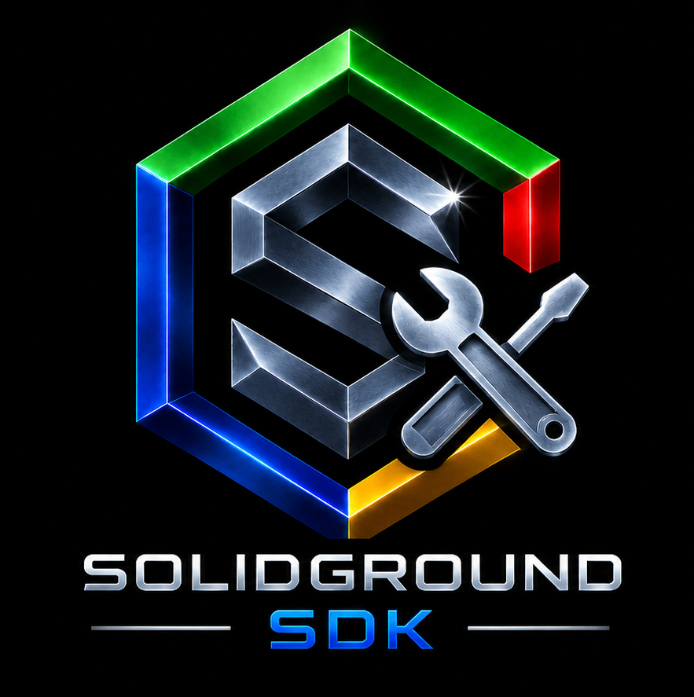

<table>
<tr>
<td width="290" align="center" valign="middle">
  
</td>
<td valign="middle">
  <h2>SolidGroundUX SDK</h2>
  <h4>Version 2.1.2630202 · © 2026 Testadura</h4>
</td>
</tr>
</table>

<table>
<tr>
<td width="33%" align="center">
  <a href="https://testadura-consultancy.github.io/SolidGroundUX/"><strong>Documentation</strong></a> 
  Product reference and guides
</td>
<td width="33%" align="center">
  <a href="CHANGELOG.md"><strong>Changelog</strong></a> 
  Releases and development history
</td>
<td width="33%" align="center">
  <a href="LICENSE"><strong>License</strong></a> 
  Terms of use and redistribution
</td>
</tr>
</table>

---

## About SolidGroundUX SDK

The **SolidGroundUX SDK** contains development, workspace, deployment and release-preparation tooling used to build and maintain SolidGroundUX-based products.

The SDK was separated from the SolidGroundUX Framework so the Framework can remain focused on runtime services and reusable APIs. SDK tools consume the installed Framework in the same way as other SolidGroundUX applications, while retaining development-root awareness when they operate on staged products.

## Responsibilities

The SDK owns tooling for:

- creating and deploying SolidGroundUX workspaces;
- working with development workspaces and canonical Framework structures;
- preparing individual product releases and first-install transport packages;
- creating public wrappers and other development/release artifacts.

The maintained **documentation bundle manager and source-to-Markdown generator** belong to **Management Console Modules (MCM)**. The website HTML generator and publisher are MCM-owned as well. Legacy documentation commands may still be present in SDK distribution trees; they are not the maintained implementation of that workflow. Installation, update, rollback and removal are handled by the Framework's standalone `sgnd-setup`, using packages prepared by the SDK.

The SDK does **not** own the SolidGroundUX runtime or Management Console application. Those belong to the SolidGroundUX Framework and SolidGroundUX Management Console Modules respectively.

## Product-aware tooling

SDK tools are designed around product identity rather than repository identity. A workspace can contain or operate on more than one product. Release preparation can process several products while preserving each product's identity, metadata and history. MCM, rather than SDK, owns multi-repository documentation bundles.

`prepare-release` supports selecting multiple products while building **separate product release packages**, with product-specific metadata, collision checks and removal baselines. When applicable, it can also build a **first-install transport ZIP** containing `sgnd-setup.sh` and the selected product packages. This is transport packaging, not a merged product release. For multi-repository source documentation, use MCM Documentation Bundles rather than the SDK's legacy documentation scripts.

## Workspace creation

`create-workspace` creates the canonical SolidGroundUX workspace tree and project definitions, copies selected convenience templates, creates project starter scripts where requested, and prepares repository-level material such as README, changelog, license placeholder, project icon and MOTD integration.

Project descriptions are stored in the project definitions and reused when rendering generated project material rather than being duplicated as README-specific metadata.

## Framework dependency

The SDK depends on the SolidGroundUX Framework. During development, Framework-owned resources are resolved from a local Framework when one is actually present; otherwise SDK tools fall back to the installed Framework without changing the SDK's own development-root context.

## Documentation and website publishing workflow

A documentation website follows **Assemble Markdown (MCM) → Generate Website (MCM) → Publish Website (MCM)**. An ordinary Markdown website starts at **Generate Website**. These stages run independently; publishing uses generated HTML and its configured remote destination. The SDK can provide source development and deployment tools, but does not own or configure these MCM workflows.
